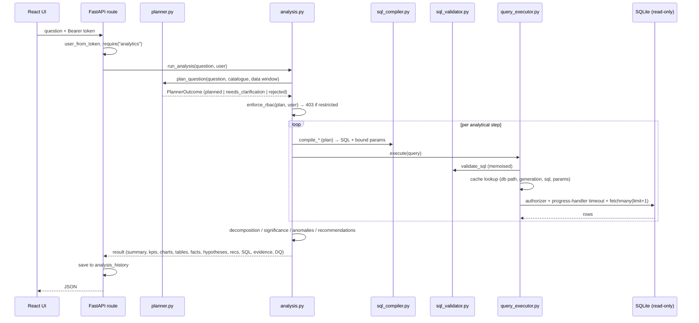

# Architecture

## Design principles

1. **Numbers come only from executed SQL.** Narrative text is filled into templates from query results. No component invents or estimates a figure.
2. **The planner is the only place natural language is interpreted.** Everything after it works on a typed, validated `AnalysisPlan`.
3. **Defence in depth for SQL.** Every query, whether compiled or typed into the sandbox, passes through the AST validator, then the SQLite authorizer, then a read-only connection.
4. **Authorization runs before SQL generation.** RBAC is checked against the plan, so restricted requests never reach the database.
5. **Deterministic end to end.** Fixed seed, fixed date window, no machine-clock dependence and no stochastic model.

## Request flow: `POST /api/analytics/analyze`

## Backend modules

| Module | Responsibility |
|---|---|
| `app/main.py` | App factory, CORS, request-logging middleware, startup (app store, demo users, active scenario DB). |
| `app/config.py` | Typed settings from `.env` (`PAYINSIGHT_*`): fixed data window, seed, limits, cache, CORS. |
| `app/api/routes.py`, `deps.py` | Thin HTTP handlers that authenticate, authorize and delegate to services. |
| `app/core/security.py` | `Role`, `ROLE_DIMENSIONS`, `ROLE_PERMISSIONS`; PBKDF2 hashing and password policy; JWT encode/decode with a pinned algorithm. |
| `app/services/auth.py` | Signup, login with lockout, refresh-token rotation with reuse detection, session listing/revocation, password change, user administration, audit log, rate limiter. |
| `app/api/auth_routes.py` | `/api/auth/*` and `/api/admin/*` endpoints; refresh cookie handling; CSRF header guard. |
| `app/core/errors.py` | Typed exceptions mapped to the `{"error": {code, message, details}}` envelope. |
| `app/core/logging.py` | JSON-lines structured logging. |
| `app/database/schema.py` | DDL, the canonical view, the materialised snapshot, indexes, table allowlist, relationships. |
| `app/database/generator.py` | Deterministic vectorised (NumPy) data generation for 5 profiles, inserted in batches of 5,000. |
| `app/database/manager.py` | Active profile, per-profile DB files, read-only connections, readers/writer lock, generation counter. |
| `app/database/app_store.py` | `app.db`: users, sessions, analysis history, settings (active scenario). |
| `app/schemas/plan.py` | `AnalysisPlan`, `TimeRange`, `Filter` (Pydantic). Validates equal-length, non-overlapping comparison periods. |
| `app/services/planner.py` | Deterministic NL → plan (see below). |
| `app/services/metrics.py` | Central metric registry and base aggregates; pp vs relative change helper. |
| `app/services/sql_compiler.py` | Plan → parameterised SQL using allowlisted dimension specs and joins. |
| `app/services/sql_validator.py` | SQLGlot AST validation, memoised. |
| `app/services/query_executor.py` | Authorizer, timeout, row cap, LRU+TTL cache, structured errors. |
| `app/services/analysis.py` | Intent handlers, RBAC enforcement, result assembly (evidence, datasets, metric definitions). |
| `app/services/decomposition.py` | Shift-share decomposition, two-proportion z-test, trailing-baseline anomaly rule. |
| `app/services/data_quality.py` | 13 checks (row-level checks in one table scan) and source reconciliation. |
| `app/services/recommendations.py` | Rule-based hypotheses and actions keyed by verdict and failure code. |
| `app/services/scenarios.py`, `dashboard.py` | Scenario catalogue and activation; dashboard overview and dataset catalogue. |

## The deterministic planner

The planner works in these steps:

1. **Normalise.** Lower-case the question, unify hyphens ("bank-level" becomes "bank level") and convert word numbers ("seven" becomes 7).
2. **Reject write intents.** Words such as *delete, drop, update the, truncate* cause the question to be refused.
3. **Extract entities.** Banks, merchants, methods, categories, regions and failure codes are matched against the **live catalogue** loaded from the database, longest match first. Matched spans are blanked so that, for example, "Deccan Commercial *Bank*" does not also trigger the bank *dimension*.
4. **Parse the time range.** It recognises `last N days|weeks|months`, `last week|fortnight|month`, `yesterday`/`today` (anchored to the last data day), month names with an optional year, ISO dates or ranges, and `all time`. Ranges are clipped to the data window with an assumption, and out-of-window requests get a clarification.
5. **Detect the metric.** Ordered regex synonym lists are used (for example *approval rate*, *conversion* and *SR* map to success rate; *GMV* and *revenue* map to TPV).
6. **Detect dimensions.** Up to 2 dimensions, using category-before-merchant precedence.
7. **Choose the intent.** Ordered rules: anomaly → mix → contribution → why/diagnose → comparison/change → trend → ranking → breakdown → KPI → clarification.
8. **Apply defaults.** Missing metric, dimension or period values are filled in and **recorded as assumptions**. Comparisons require equal-length history, or the planner asks for clarification.
9. **Validate.** The plan is validated by Pydantic. The planner output also carries matched terms and a heuristic confidence score shown in the UI.

**Extension point:** an optional local LLM could be added as an alternative *front end* to step 5–7 that emits the same `AnalysisPlan`. Nothing downstream would change. It is not installed and the core does not depend on it.

## Analysis intents

| Intent | Queries executed | Reasoning |
|---|---|---|
| `kpi` | aggregate + daily context | numerator/denominator, status split, eligibility exclusions |
| `breakdown` / `ranking` | grouped aggregate + overall benchmark | shares, vs-overall pp, low-sample flags, laggard hypotheses |
| `trend` | daily (optionally × segment) | min/max, last-7 vs prior-7, anomaly flags |
| `period_comparison` | period × (segment) aggregates + daily | pp and relative change, z-test, segment contribution |
| `contribution` / `mix_decomposition` | period × segment | shift-share decomposition and verdict |
| `diagnose` | overall + 5 dimensions × period + daily + failure-code drill-down | dimension scan, verdict classification, concentrated vs broad deterioration |
| `anomaly_daily` | daily with 14-day baseline | trailing mean ± 3σ (heuristic) |
| `segment_outliers` | per segment + failure codes of top outlier | binomial z ≥ 3 with ≥ 50 eligible attempts (heuristic) |

**Verdict rules for `diagnose`.** Let Δ be the aggregate success-rate change.
- If |Δ| < 0.3 pp, or the change is not significant (|z| < 2), the verdict is **no material change**.
- Otherwise, if some dimension's mix effect is ≥ 60 % of Δ, the verdict is **mix shift**.
- Otherwise, if some dimension's mix effect is ≥ 30 % of Δ, the verdict is **both**.
- Otherwise, the verdict is **performance deterioration**: concentrated if the top segment carries ≥ 50 % of Δ, broad-based if not.

## Data lifecycle and scenarios

- Each data profile (`baseline`, `bank_decline`, `mix_shift`, `data_quality`, `source_discrepancy`) is a separate SQLite file. All profiles share one RNG stream, so they differ **only** by their seeded effect.
- Activating a scenario switches the active file under a write lock and increments the `generation` counter, which invalidates the cache. A reseed rebuilds into a temporary file and swaps it in atomically.
- `app.db` is separate, so users and history survive reseeds and analytical connections can stay strictly read-only.

## Frontend

The frontend uses React with typed API models (`src/types/api.ts`) and one fetch wrapper (`src/services/api.ts`). The JWT access token is kept in memory only; the refresh token is an httpOnly cookie. On a `TOKEN_EXPIRED` response the client refreshes once (single-flight across concurrent requests) and retries, and on page load it restores the session from the cookie. If the server revokes the session, the app returns to the login page with a notice. Errors from the backend envelope are surfaced as `ApiError`.

| Page | Contents |
|---|---|
| Login | Sign in / Create account tabs, live password-policy checklist, demo-account picker |
| Dashboard | KPI cards with period deltas, daily trend, method/bank/failure-code charts |
| Analytics Workspace | Question box, scenario suggestions, history, result view and Explainability panel |
| Data Quality & Sources | Checks, reconciliation, dataset catalogue, SQL sandbox |
| Demo Scenarios | Scenario cards with one-click activation |
| Users & Audit (ADMIN) | Role assignment, enable/disable, unlock, force sign-out; filterable security audit log |
| Account & Security | Profile, permissions, active sessions with revoke, sign out everywhere, change password |

Charts follow the validated categorical palette. They never use dual axes: metric and volume are drawn as two aligned panels. Rate comparisons that must start at zero use failure rate, so real differences stay visible.
